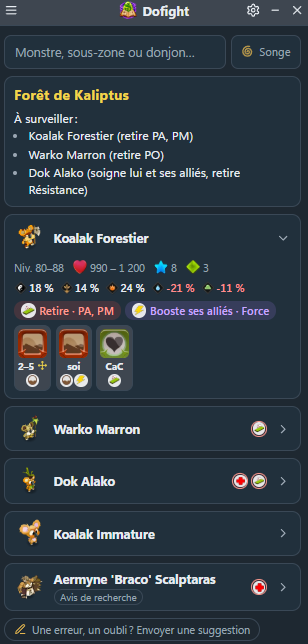

<h1 align="center">Dofight</h1>

  <b>L'assistant de combat pour Dofus 3.</b> 
  Un panneau à côté du jeu qui te montre les dangers des monstres autour de toi.

  <a href="https://github.com/dofight/dofight/releases/latest"><b>⬇ Télécharger pour Windows</b></a>
  · <a href="https://discord.gg/G8G4cyvpx6">Discord</a>
  · <a href="#english">English</a>

  
  
  

  

Gratuit et open source. Dofight lit uniquement **le coin en haut à gauche de la fenêtre Dofus** (le nom de la
sous-zone, tes coordonnées et la barre d'icônes, qui lui indique qu'un combat commence), et cette lecture se coupe
d'un clic (Paramètres → « Lecture de l'écran »). Il ne joue pas à ta place, n'envoie rien au jeu et ne lit ni sa mémoire, ni ses fichiers, ni son
trafic réseau.

Pour chaque monstre de ta sous-zone, de ton donjon ou de ton combat, il t'indique ce qui peut te faire perdre
(one-shots, invulnérabilités, mécaniques), ses résistances et ses sorts.

## Avant de commencer

- Windows 10 ou 11, et Dofus 3 (en français ou en anglais).
- Le français parmi les langues de Windows (Paramètres Windows → Heure et langue → Langue et région) : Dofight s'en
  sert pour lire le texte à l'écran. Si ton Windows est en français, tu n'as rien à faire.

## Installation

1. Ouvre la page de la [dernière version](https://github.com/dofight/dofight/releases/latest) et télécharge le fichier
   `Dofight_…_x64-setup.exe` (les autres fichiers servent aux mises à jour).
2. Lance-le. Si Windows affiche « Windows a protégé votre ordinateur », clique sur « Informations
   complémentaires », puis sur « Exécuter quand même » : Dofight est un petit projet, qui n'a pas de certificat
   payant.
3. Dans Dofus, active **« Afficher les coordonnées de la carte »** dans les options (Interface → Cartes) : Dofight lit le nom de la
   sous-zone juste au-dessus des coordonnées.
4. Laisse dépliée la barre d'icônes en haut à gauche du jeu (l'œil hors combat, le cœur en combat) : c'est elle
   qui indique à Dofight qu'un combat commence.

Et voilà : lance Dofus, Dofight affiche les monstres de ta sous-zone et s'ouvre tout seul en combat.
**Ctrl+Maj+D** l'affiche ou le cache (raccourci modifiable dans les paramètres). Les mises à jour sont automatiques.

**Désinstaller :** Paramètres Windows → Applications → Applications installées → Dofight → Désinstaller.

## Ce que fait Dofight

- **Les monstres autour de toi** : ceux de ta sous-zone ou de ton donjon, affichés dès que tu y entres.
- **Ce qui est dangereux, d'un coup d'œil** : des badges (danger, conseil, mécanique) et un court résumé rédigé à
  partir des guides. La fiche du boss est dépliée ; pour les autres monstres, les dangers apparaissent directement
  sur leur ligne.
- **Résistances et sorts** de chaque monstre, avec le détail de chaque sort.
- **Les grosses mécaniques expliquées** (cycle lunaire, vagues de monstres, modificateurs de dimension…) : survole
  la pastille « ⓘ » pour un aperçu, clique pour l'épingler.
- **Mode Songe** : il s'active tout seul quand tu entres dans un Songe ; survole un groupe de monstres sur la carte
  et Dofight l'affiche avant le combat.
- **Recherche** d'un donjon, d'une sous-zone ou d'un monstre ; « Aller en [x,y] » copie la commande de voyage à
  coller dans le chat.
- **Discret** : il s'ouvre au début du combat et se ferme à la fin, et Ctrl+Maj+D l'affiche ou le cache.
- **À ton goût** : thèmes assortis à ceux de Dofus, taille du texte, opacité, interface en français ou en anglais.

## Questions fréquentes

**C'est autorisé ?** Dofight n'est ni un bot ni un mod : il ne clique pas, n'envoie rien au jeu et ne modifie
rien. Il lit uniquement le coin en haut à gauche de la fenêtre Dofus (le nom de la sous-zone, tes coordonnées et la
barre d'icônes), et seulement quand Dofus est au premier plan ; en combat, il surveille surtout la barre d'icônes,
pour voir la fin du combat ; en mode Songe, il lit aussi l'infobulle du groupe sous ta souris. Tu peux couper cette lecture dans
Paramètres → « Lecture de l'écran » : Dofight ne capture alors plus du tout la fenêtre Dofus. Il affiche des
informations publiques (données du jeu, guides). C'est un outil fait par des fans, sans lien avec Ankama, qui ne l'a
ni validé ni approuvé : tu l'utilises sous ta propre responsabilité.

**Qu'est-ce que Dofight envoie sur Internet ?** Rien pendant que tu joues : pas de compte, pas de statistiques.
Il contacte GitHub pour ses mises à jour. Si tu envoies une suggestion, il transmet ton message et, si tu laisses
les deux cases cochées, l'état de Dofight (sous-zone lue, combat, version, paramètres) et son journal des 10
dernières minutes. Jamais de capture d'écran ni de chat, ni de nom de personnage, de guilde ou de compte.

**Dofight n'affiche rien, ou pas les bons monstres ?** Revérifie les étapes 3 et 4 de l'installation, et assure-toi
que le français fait bien partie des langues de Windows. Si tu joues sur plusieurs comptes, choisis la fenêtre à lire dans
Paramètres → Lecture de l'écran.

**Une erreur, une idée, besoin d'aide ?** Le bouton « Envoyer une suggestion » (en bas des résultats) envoie ton
message à l'équipe, de façon anonyme. Si tu veux une réponse, passe par le [Discord](https://discord.gg/G8G4cyvpx6).

Dofight est gratuit. Si tu veux soutenir le projet : [Ko-fi](https://ko-fi.com/dofight).

Dofight est un outil fait par des fans, sans lien avec Ankama. Dofus, ses noms, ses images et ses données appartiennent à
Ankama Games.

---

## English

The fight assistant for Dofus 3: a panel beside the game that shows what is dangerous about the monsters around
you (one-shots, invulnerabilities, mechanics), with their resistances and spells. Free and open source. Dofight
only reads **the top-left corner of the Dofus window** (the subarea name, your coordinates and the icon bar, which
tells it when a fight starts), and one click turns that off (Settings → “Screen reading”). It does not play for you, sends nothing to
the game and reads neither its memory, its files nor its network traffic.

### What you need

- Windows 10 or 11, and Dofus 3 (French or English client).
- French among your Windows languages (Windows Settings → Time & language → Language & region → Add a language →
  Français): Dofight uses it to read the text on screen, even with the game in English. You do not have to switch
  Windows to French.

### Install

1. Open the [latest release](https://github.com/dofight/dofight/releases/latest) and download
   `Dofight_…_x64-setup.exe` (the other files are for updates).
2. Run it. If Windows shows “Windows protected your PC”, click “More info”, then “Run anyway”: Dofight is a small
   project without a paid certificate.
3. In Dofus, turn on **“Show map coordinates”** in the options: Dofight reads the subarea name just above them.
4. Keep the icon bar in the game's top-left corner expanded (the eye out of combat, the heart in combat): it tells
   Dofight when a fight starts.

That's it: start Dofus, and Dofight shows the monsters of your subarea and opens by itself in fights.
**Ctrl+Shift+D** shows or hides it (you can change it in the settings). Updates install themselves.
The interface is in French by default: switch to English in Paramètres → Langue.

**Uninstall:** Windows Settings → Apps → Installed apps → Dofight → Uninstall.

### What it does

- **The monsters around you**: those of your subarea or dungeon, shown as soon as you enter it.
- **What is dangerous, at a glance**: badges (danger, tip, mechanic) and a short summary written from the guides.
  The boss is expanded; the others show their dangers on their line.
- **Resistances and spells** of each monster, with a detailed sheet for each spell.
- **The big mechanics explained** (lunar cycle, monster waves, dimension modifiers…): hover over the “ⓘ” chip for a
  preview, click to pin it.
- **Songe mode**: it turns on by itself when you enter a Songe; hover over a monster group on the map and Dofight
  shows it before the fight.
- **Search** for a dungeon, a subarea or a monster; “Go to [x,y]” copies the travel command to paste in the chat.
- **Out of the way**: it opens when a fight starts and closes when it ends; Ctrl+Shift+D shows or hides it.
- **Your way**: themes matching Dofus's, text size, opacity, French or English interface.

Summaries are available in English; the linked guides are in French.

### FAQ

**Is it allowed?** Dofight is neither a bot nor a mod: it does not click, sends nothing to the game and changes
nothing. It only reads the top-left corner of the Dofus window (the subarea name, your coordinates and the icon
bar), and only while Dofus is in the foreground; in a fight, it mostly watches the icon bar, to see the fight end;
in Songe mode, it also reads the tooltip of the group under your mouse. You can turn this off in Settings
→ “Screen reading”: Dofight then no longer captures the Dofus window at all. It shows public information (game data,
guides). It is a fan-made
tool, not affiliated with, reviewed or approved by Ankama: you use it at your own risk.

**What does Dofight send over the Internet?** Nothing while you play: no account, no statistics. It contacts
GitHub for its updates. If you use “Suggestion”, it sends your message and, if you leave both switches on,
Dofight's state (subarea read, fight, version, settings) and its log of the last 10 minutes. Never a screenshot,
the chat, or a character, guild or account name.

**Dofight shows nothing, or the wrong monsters?** Check steps 3 and 4 of the install, and that French is among
your Windows languages. If you play several accounts, pick the window to read in Settings → Screen reading.

**A mistake, an idea, need help?** The “Send a suggestion” button (at the bottom of the results) sends it anonymously to
the team. For an answer, use the [Discord](https://discord.gg/G8G4cyvpx6).

Dofight is free. To support the project: [Ko-fi](https://ko-fi.com/dofight).

---

## Contributing

Dofight is open source (MIT). Found a wrong summary or a bug? You can help without writing code: see
[CONTRIBUTING.md](CONTRIBUTING.md), which also covers building the app and running the tests.

## Credits

Dofight is a fan-made tool, not affiliated with Ankama. Dofus, its names, images and game data belong to Ankama
Games. The MIT licence covers Dofight's code and its own summaries, not the game data, names and images.

- Game data and icons: [Dofensive](https://dofensive.com), [DofusDB](https://dofusdb.fr).
- Travel data (zaaps, dungeon entrances, map positions): [DofusDB](https://dofusdb.fr).
- Dungeon summaries: written with the help of [Dofus pour les Noobs](https://www.dofuspourlesnoobs.com); every
  summary links to its guide.
